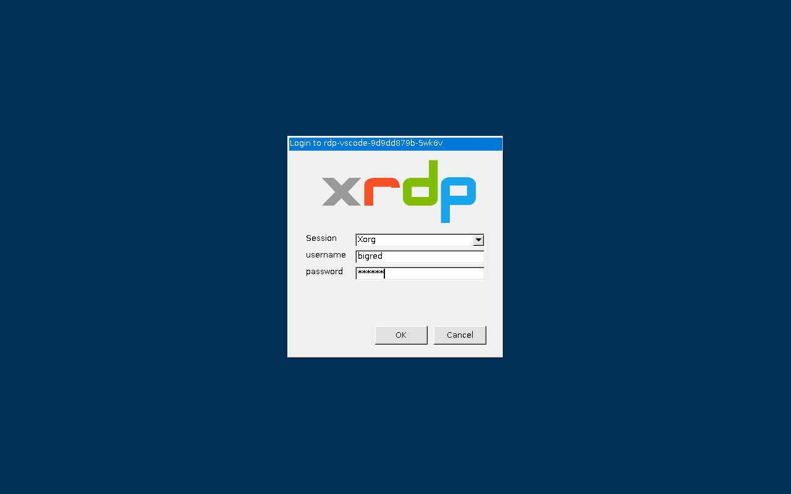
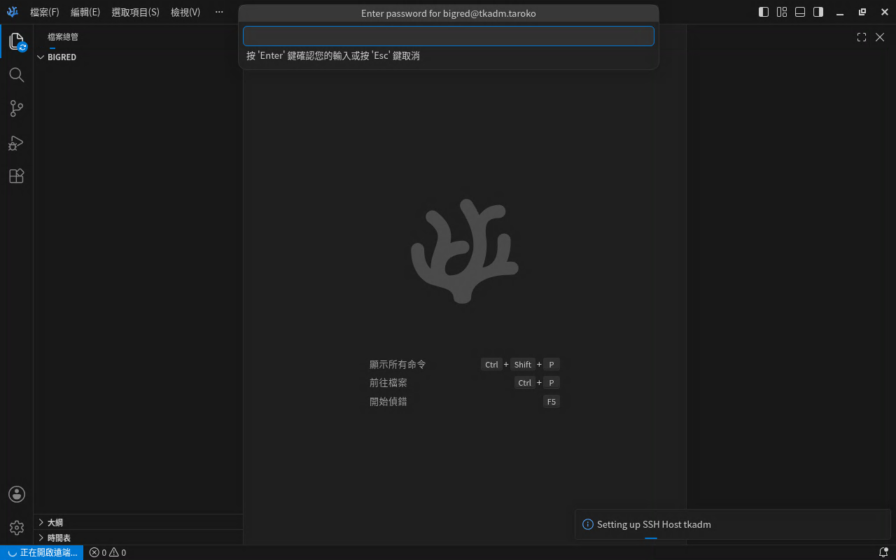
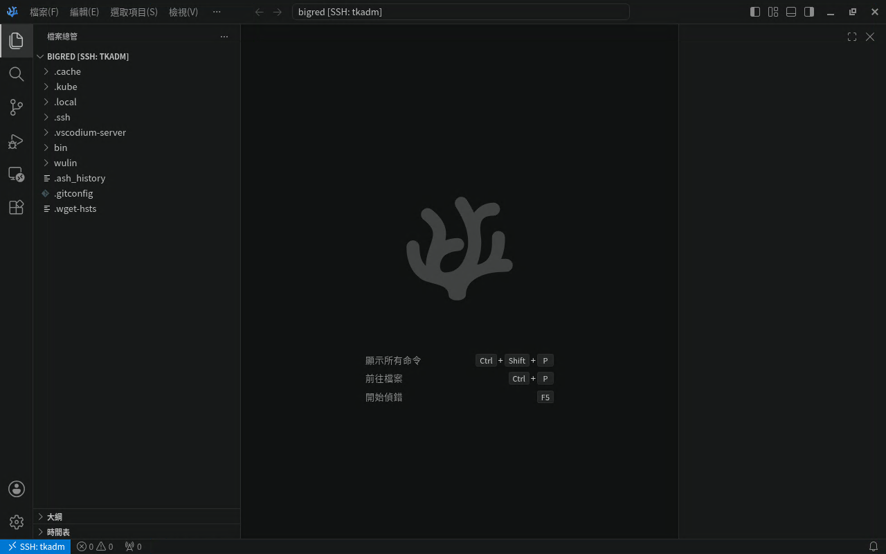
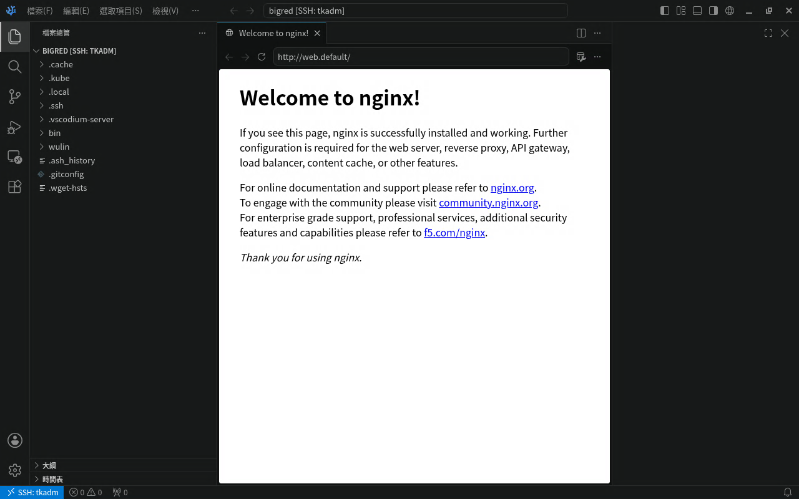

# rdp-vscode

用 Windows 內建的遠端桌面連進 Kubernetes 叢集，登入後就是一個全螢幕的 VSCodium（VS Code 的開源版本）。它會自動用 SSH（加密的遠端連線）連到叢集的管理 Pod tkadm，讓你直接在上面編輯檔案、執行 `kubectl`。

多人可以同時使用，每次登入都有自己的桌面。預設同時最多 3 個桌面，數量可以調整。

## 簡述

- 登入後 VSCodium 在叢集裡執行，由它的 Open Remote-SSH 擴充功能自動以 SSH 連到 tkadm。檔案總管和終端機都在 tkadm 上，kubeconfig（`kubectl` 連叢集用的設定檔）不必離開叢集。
- 用內建的 Integrated Browser 開 `http://<service>.<namespace>`（例如 `http://web.default`），就能直接連到叢集內的 Web 服務。
- 對外只要開一個 NodePort（Kubernetes 在每個節點上開放的固定埠號，這裡是 30390），不必另外設定其他對外方式。
- Windows 內建的遠端桌面就能連線，不用在自己的電腦安裝 VS Code 或擴充功能。
- 多個帳號、甚至同一個帳號都能同時登入。不同帳號在這個 Pod 裡看不到彼此的家目錄，但連到 tkadm 後都是同一個使用者。
- 已預裝繁體中文語言包。第一次連到 tkadm 時會自動安裝 YAML 擴充功能，編輯 Kubernetes YAML 時就有欄位提示。
- 要保留設定就用 stateful 模式：`/home` 放在 PVC（向叢集申請的永久儲存空間），Pod 重建後 VSCodium 的設定和裝在 Pod 裡的擴充功能都還在。

## 架構


用戶端以遠端桌面協定 RDP 連到節點的 NodePort `30390`，再經 Service `rdp-vscode` 轉到 Pod 的 3389 埠。Pod 裡只有一個 container（容器），裡面跑著這些 process（執行中的程式）和 session（一組 process 組成的桌面工作階段）：

- ① xrdp／xrdp-sesman：接收 RDP 連線、顯示登入畫面、驗證帳號，並替每次登入開一個新桌面
- ② Xorg session：每次登入各一個桌面，執行全螢幕的 VSCodium；關掉 VSCodium 就登出
- ③ vscodium-server：VSCodium 以 SSH 連到 namespace `taroko` 的 tkadm（`tkadm.taroko:22100`）後，在上面啟動的服務端程式；檔案和終端機都在 tkadm 上

詳細說明見 [docs/architecture.md](docs/architecture.md)。

## 先決條件

### Kubernetes 叢集

- kubectl、curl、bash（用 Kustomize 安裝時另外需要 git）。kubectl 已內建 Kustomize（組合 YAML 設定的工具，`kubectl apply -k` 就是用它）
- kubeconfig（通常在 `~/.kube/config`），而且權限要夠 `install.sh` 用：建立和更新 Namespace、Deployment、Service、Secret（Kubernetes 存放密碼等敏感資料的物件；stateful 模式另外要 PVC），讀取 Deployment 和 Service，列出 Node，以及列出和刪除 namespace `rdp-vscode` 裡舊的 `rdp-vscode-users-*` Secret
- 節點能連到 `ghcr.io` 下載映像檔（約 1.3 GB）
- 資源：Pod 需求 0.5 CPU／1 GiB，上限 4 CPU／4 GiB（以 3 人同時使用估算）
- NodePort `30390` 沒有被占用，而且用戶端連得到節點的 TCP 30390 埠（防火牆要放行）
- SSH 目標預設是 namespace `taroko` 的叢集管理 Pod tkadm（`tkadm.taroko:22100`，裡面已經有 kubectl 和 kubeconfig）。tkadm 要另外部署，本 repo 不提供，它需要：
  - sshd（SSH 伺服器）允許埠轉發，也就是允許透過 SSH 轉送其他網路連線，見 [docs/ops/2026-10-27-tkadm-sshd-forwarding.md](docs/ops/2026-10-27-tkadm-sshd-forwarding.md)
  - 能連到 `github.com` 和 `open-vsx.org`：第一次連線時，tkadm 會自己下載 vscodium-server 和 YAML 擴充功能
- 要連到其他主機，請調整[環境變數](#環境變數) `SSH_HOST` 等設定

### 遠端桌面用戶端

- **Windows**：內建的「遠端桌面連線」（`mstsc`）
- **macOS**：Mac App Store 的 Windows App；新增 PC 時 Credentials 選 **Ask when required**，才會出現 xrdp 登入畫面（未實測）

## 快速開始

在已安裝 kubectl、curl、bash，而且連得到目標叢集的電腦上執行：

```bash
curl -fsSL https://raw.githubusercontent.com/braveantony/rdp-vscode/main/install.sh | bash
```

腳本會部署到 namespace `rdp-vscode`，完成後印出每個節點的連線位址。用遠端桌面連到 `<節點 IP>:30390`，帳號 `bigred`、密碼 `bigred`。

這個快速安裝只有一個帳號，也不會保留設定。多帳號、自訂密碼或保留 home（這三項都要改用 Kustomize 部署）、沒有 Kubernetes 時的單機 podman、節點在內部網段時怎麼從區網連線，以及怎麼移除，都在[安裝手冊](docs/install.md)。

## 怎麼用

### 1. 登入

按 `Win+R`，輸入 `mstsc` 開啟「遠端桌面連線」，再連到上面的位址。出現憑證警告時按「是」。Pod 每次啟動都會產生自己的憑證，所以重建後會再次出現警告。接著會看到 xrdp 登入畫面，Session 維持 `Xorg` 不用改，輸入帳號密碼後按 OK。



### 2. 連到 tkadm

登入後會看到全螢幕的 VSCodium，上方會跳出 `Enter password for bigred@tkadm.taroko`。輸入 tkadm 上 `bigred` 帳號的 SSH 密碼，然後按 Enter。這是另一組密碼，由 tkadm 決定；本專案的測試叢集 tk8s 上是 `bigred`，其他環境請問管理者。左下角變成 `SSH: tkadm`，檔案總管列出 tkadm 上的 `/home/bigred`，就代表連上了。





tkadm 上還沒有這個版本的 vscodium-server 時（第一次連線、tkadm 重建後，或映像檔換成不同 VSCodium 版本之後），tkadm 會先從 `github.com` 下載約 90 MB，要多等一下。之後每次重新連線（包括「重新載入視窗」）都會再問一次密碼。

### 3. 在 tkadm 部署網站，用叢集內的網址開啟

按 `` Ctrl+` `` 開啟終端機（在 tkadm 上執行），在 namespace `default` 部署一個 nginx（如果 `default` 裡已經有叫 `web` 的資源，換一個名稱）：

```bash
kubectl -n default create deploy web --image=nginx
kubectl -n default expose deploy web --port 80
```

按 `Ctrl+Shift+P`，執行「Browser: Open Integrated Browser」（或按標題列右邊的地球圖示），在網址列輸入 `http://web.default`，就會看到 nginx 的歡迎頁。



網址可以用短名稱 `http://<service>.<namespace>`，也可以用完整網域名稱（見[使用手冊](docs/user-guide.md)）。服務的埠號不是 80 時，在網址後加上 `:<埠號>`。

> 在終端機裡按住 `Ctrl` 點網址時，不會用 Integrated Browser 開啟；映像檔裡沒有其他瀏覽器，所以不會有反應。

### 4. 使用時要知道的事

- 按 `Ctrl+Q` 或右上角的關閉按鈕關掉 VSCodium，就會登出並中斷遠端桌面。
- 斷線後無法接回原本的桌面。重新連線一定會開新桌面，原本的桌面會在斷線 2 分鐘後關閉，**未存檔的修改會遺失**。已存檔的檔案在 tkadm 上，不受影響。
- Pod 裡沒有中文輸入法。請在自己的電腦打好、複製，再到 VSCodium 按 `Ctrl+V` 貼上。
- 不同的 RDP 帳號連到 tkadm 後都是同一個使用者 bigred，彼此看得到、也改得到對方的檔案。

完整的操作說明和常見問題見 [docs/user-guide.md](docs/user-guide.md)。

## 映像檔

映像檔是 `ghcr.io/braveantony/rdp-vscode:1.3`，約 1.3 GB，內含 VSCodium 1.143.17183、Open Remote-SSH 0.5.1、繁中語言包 1.131.0，以及 Cascadia Code、JetBrains Mono 字型。各版本的說明見 [Releases](../../releases)。

## 文件

- [install.md](docs/install.md)：安裝手冊（快速安裝、Kustomize 多帳號與保留 home、單機 podman、從區網連線、移除）
- [architecture.md](docs/architecture.md)：系統運作架構（連線路徑、Pod 內各 process 的職責、安全邊界）
- [user-guide.md](docs/user-guide.md)：使用手冊（連線登入、連到 tkadm、開網站、多人使用、常見問題）
- [build-image.md](docs/build-image.md)：建置手冊（從原始碼建置兩個 tag、測試，到部署上 tk8s 的完整步驟）
- [design/](docs/design/README.md)：設計決策、驗收標準、風險與審查紀錄
- [ops/](docs/ops/)：為了本專案對 tk8s 做的修改紀錄（tkadm sshd、local-path StorageClass）

## 環境變數

先依[安裝手冊](docs/install.md#kustomize多個帳號與保留-home) clone 這個 repo，改 `manifests/base/deployment.yaml` 的 `env`，再執行一次 `kubectl apply -k manifests/stateless`（或 `manifests/stateful`，看你用哪一個）。

| 變數 | 預設值 | 說明 |
|---|---|---|
| `USERS_FILE` | `/etc/rdp-vscode/users` | 帳號檔案，一行一個 `帳號:密碼`；Kubernetes 上一定會由 Secret `rdp-vscode-users-*` 掛載 |
| `RDP_USER` | `bigred` | 沒有帳號檔案時的登入帳號（UID 1000）；Kubernetes 上一定有帳號檔案，用不到 |
| `RDP_PASSWORD` | — | 沒有帳號檔案時的登入密碼，此時必填；Kubernetes 上用不到 |
| `MAX_SESSIONS` | `3` | 可以同時存在的桌面數上限（所有帳號合計，斷線後 2 分鐘內還沒清除的桌面也算在內）；每多一個桌面，約需多 1 GiB 記憶體 |
| `SSH_HOST_ALIAS` | `tkadm` | 登入時 VSCodium 自動連線的 SSH `Host` 名稱；設成空字串就不自動連線 |
| `SSH_HOST` | `tkadm.taroko` | SSH 目標的主機名稱或 IP；預設用短名稱（`<service>.<namespace>`），不必知道叢集的網域名稱（cluster domain，常見的是 `cluster.local`） |
| `SSH_PORT` | `22100` | SSH 埠 |
| `SSH_USER` | `bigred` | SSH 帳號 |
| `SSH_REMOTE_FOLDER` | `/home/<SSH_USER>` | 連線後在 SSH 目標上開啟的資料夾；`manifests/base/deployment.yaml` 已明確設成 `/home/bigred`，改 `SSH_USER` 時要一起改 |
| `VSCODIUM_LOCALE` | `zh-tw` | 介面語言：`zh-tw` 或 `en` |
| `VSCODIUM_FONT` | `cascadia-code` | 編輯器和終端機的預設字型：`cascadia-code`、`jetbrains-mono` 或 `noto`（Noto Sans Mono CJK TC）；中文一律用 Noto Sans Mono CJK TC 顯示。帳號在 VSCodium 裡自己設定過字型時，以自己的設定為準 |

SSH 設定會寫到 `/etc/ssh/ssh_config.d/rdp-vscode.conf`。如果掛載了 ConfigMap `rdp-vscode-ssh`（key 為 `config`）且內容不是空的，就會整份改用它；這時 ConfigMap 裡要有名稱等於 `SSH_HOST_ALIAS` 的 `Host`。

## 檔案

| 路徑 | 說明 |
|---|---|
| `VERSION` | 目前版本 |
| `images/rdp-vscode/Dockerfile` | 映像檔定義（基底 `debian:trixie-slim`） |
| `images/rdp-vscode/rootfs/` | 複製進映像檔 `/` 的設定檔與腳本（entrypoint、帳號、SSH 設定、桌面的啟動與清理） |
| `install.sh` | 快速安裝用的 `curl \| bash` 腳本（帳號密碼 `bigred`／`bigred`、`/home` 用 emptyDir） |
| `manifests/base/` | Kustomize base（共用的基本設定）：Namespace、Deployment、NodePort Service（30390） |
| `manifests/stateless/`、`manifests/stateful/` | 兩種 overlay：由 `users.txt` 產生 Secret，`/home` 分別用 emptyDir 和 PVC |
| `manifests/example/ssh-configmap/` | 用 ConfigMap 取代 SSH 設定的範例 |
| `docs/` | 架構說明、使用手冊、建置文件、架構圖（`docs/architecture/`）、README 截圖（`docs/images/`）、設計文件 |
| `test/` | 單元測試、映像檔測試、部署測試，以及在 tk8s 上執行的端到端驗收（`test/e2e/`） |

## 安全警告

預設帳密 `bigred`／`bigred` 只適合隔離的實驗叢集。能連到 NodePort 30390 的人，用這組帳密就能進到叢集內部網路，再以 SSH 連到 tkadm，用那裡的 `kubectl` 控制整個叢集。部署到其他環境前，請改用[多個帳號](docs/install.md#kustomize多個帳號與保留-home)並設定自己的密碼。

## 授權

[Apache-2.0](LICENSE)
