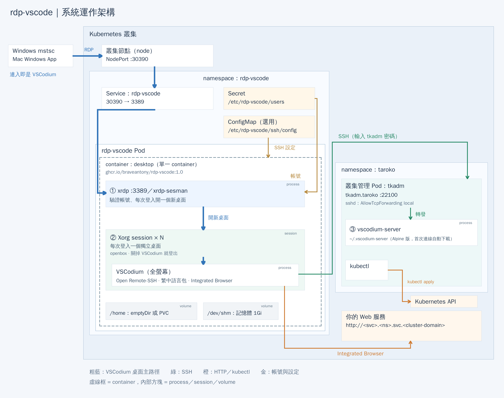

# rdp-vscode 系統運作架構

適用映像檔：`ghcr.io/braveantony/rdp-vscode:1.0`

圖中的編號、顏色與下文對應。架構圖的原始檔與重製方式見 [architecture/README.md](architecture/README.md)。

## 連線路徑（粗藍線）

1. 使用者在 Windows 用「遠端桌面連線」（`mstsc`），或在 Mac 用 Windows App，以 **RDP** 連到叢集任一節點的 **NodePort `30390`**（Kubernetes 在每個節點上開放的固定埠號）。
2. NodePort 屬於 namespace（Kubernetes 用來分組資源的名稱空間）`rdp-vscode` 的 **Service `rdp-vscode`**，它把 30390 轉到 Pod 的 **3389** 埠。你連的節點不一定是 Pod 所在的節點，Kubernetes 會自動轉送過去。
3. 連線進入 **rdp-vscode Pod**。登入後，使用者看到的就是全螢幕的 VSCodium。

## Pod 內部

Pod 只有**一個 container `desktop`**，也就是圖中的虛線框。框內的方塊代表這個 container 裡的 **process**（執行中的程式）或 **session**（由一組 process 組成的桌面工作階段，即 ②），分成兩批啟動：

- **container 啟動時**：由 `tini`（container 裡第一個啟動的小程式，負責啟動和回收其他程式）執行 `/opt/rdp-vscode/entrypoint.sh`。它依序建立登入帳號、產生 SSH 設定、產生這個 Pod 專用的 TLS 憑證和 RSA 金鑰，最後啟動 ①。
- **使用者登入時**：由 xrdp-sesman 執行 `/etc/xrdp/startwm.sh`，啟動 ②。

xrdp 或 xrdp-sesman 結束時，container 就會停止，由 Kubernetes 重啟。VSCodium 結束只會讓那一個桌面登出，不影響 container。

| # | process | 職責 |
|---|---|---|
| ① | **xrdp** `:3389`／**xrdp-sesman** | RDP 入口。xrdp 接收連線並顯示登入畫面；xrdp-sesman 用 PAM（Linux 的帳號密碼驗證機制）驗證帳號，再替每次登入開一個新桌面（②）。同時存在的桌面上限是 `MAX_SESSIONS`（預設 3） |
| ② | **Xorg session × N** | 每次登入就開一個 session（一個獨立的桌面，有自己的 Xorg 畫面伺服器），同一個帳號登入兩次也是兩個桌面。桌面裡跑 openbox（視窗管理程式，讓視窗全螢幕、沒有邊框）和**全螢幕的 VSCodium**。關掉 VSCodium 就登出；斷線後無法接回，桌面會在 2 分鐘後清除 |

### 每個桌面怎麼啟動與清除

`startwm.sh` 以登入帳號的身分執行：

1. 建立這個桌面專用的目錄 `/tmp/sess/<display>.<uid>/`：`data/` 是 VSCodium 的資料目錄，`run/` 是執行期目錄。目錄名稱包含顯示編號（display，第一個桌面是 10）和 UID，所以同一個帳號的兩個桌面不會共用 VSCodium。目錄已經存在而且不屬於自己時（例如被別的帳號先建立），就拒絕啟動。
2. `data/User` 是指向 `~/.config/VSCodium/User` 的 symlink（捷徑），所以同一個帳號的設定在每個桌面都相同，stateful 模式下也會保留。
3. `sync-extensions.sh` 用 `codium --install-extension` 把映像檔裡的 Open Remote-SSH 和繁中語言包裝到 `~/.vscode-oss/extensions`。版本相同就跳過，版本不同就換掉，使用者自己裝的 extension 不受影響。
4. 產生 `languagepacks.json`，讓 `--locale=zh-tw` 在第一次啟動就生效（VSCodium 原本要第二次啟動才會套用語言）。
5. 啟動 openbox，再啟動 VSCodium：`--remote=ssh-remote+tkadm /home/bigred`，一開啟就連到 tkadm。
6. VSCodium 結束（使用者關閉）或收到 SIGTERM（斷線 120 秒後 sesman 送出）時，清除 VSCodium、D-Bus 和整個 `/tmp/sess/<display>.<uid>/`，桌面隨即結束。

## 其他連線

- **綠線（SSH）**
  - VSCodium 的 Open Remote-SSH 以 SSH 連到 namespace `taroko` 的**叢集管理 Pod tkadm**（`tkadm.taroko:22100`），使用者在密碼框輸入 tkadm 的密碼。tkadm 需另外部署，本 repo 不提供。
  - 第一次連線時，Open Remote-SSH 在 tkadm 上下載並啟動 **③ vscodium-server**（Alpine 版，放在 `~/.vscodium-server`），並自動安裝 YAML extension。之後 VSCodium 透過 SSH 的本機埠轉發連到 ③，所以 tkadm 的 sshd 必須是 `AllowTcpForwarding local`（或 `yes`）。
  - 檔案總管、編輯器和終端機都在 tkadm 上執行；終端機裡的 `kubectl` 用的是 tkadm 的 kubeconfig。
  - SSH 設定由 entrypoint 依 `SSH_*` 環境變數寫到 `/etc/ssh/ssh_config.d/rdp-vscode.conf`；掛載了內容不是空的 ConfigMap `rdp-vscode-ssh` 時，改用它的內容。
- **橙線（HTTP）**：VSCodium 的 Integrated Browser 就在 Pod 裡，所以能用 `http://<service>.<namespace>` 直接開叢集內的 Web 服務，不必另外對外開放。
- **金線（帳號與設定）**
  - Secret（Kubernetes 存放密碼等敏感資料的物件）`rdp-vscode-users-<雜湊>` 以唯讀方式掛載到 `/etc/rdp-vscode/users`，每行一個 `帳號:密碼`。
  - container 啟動時，`entrypoint.sh` 依這個檔案建立登入帳號（UID，也就是 Linux 帳號的數字編號，從 1000 起），① 的 xrdp-sesman 用這些帳號驗證登入。每個帳號的 home 權限是 `0700`。
- **儲存**：`/home` 依 overlay 是 emptyDir（Pod 刪掉就跟著消失）或 PVC `rdp-vscode-home`；`/dev/shm` 是 1 GiB 的記憶體空間，因為用預設的 64 MB 時，VSCodium 載入中文字型會崩潰。

## 安全邊界

- 叢集外只有 NodePort `30390`（RDP）一個入口。
- 登入後就在叢集內部網路裡：VSCodium、Integrated Browser 和本機終端機都連得到叢集內所有 ClusterIP Service。再加上 tkadm 的 kubectl，**預設帳密等於整個叢集的控制權**，只適合隔離的實驗環境。
- xrdp 與 xrdp-sesman 以 root 執行（Debian trixie 的 xrdp 0.10.1 不支援降權；sesman 本來就需要 root 才能驗證帳號、切換成登入者）；Xorg、openbox、VSCodium 以登入者的身分執行，container 設了 `allowPrivilegeEscalation: false`。
- 不同帳號的 home 彼此看不到（`0700`）；從帳號清單移除的帳號，home 會改成 root 擁有。但所有帳號連到 tkadm 後都是同一個 bigred，會共用那裡的檔案與 kubectl 權限。
- TLS 憑證與 RSA 金鑰在每個 Pod 啟動時產生，不寫進映像檔；密碼來自 Secret，也不寫進映像檔。
- 連 tkadm 時不檢查 SSH host key（tkadm 重建後 host key 會改變），所以叢集內如果有人冒充 `tkadm.taroko`，就可能拿到使用者輸入的密碼。
- tkadm 的 kubeconfig 留在叢集內，不必流出到用戶端。
