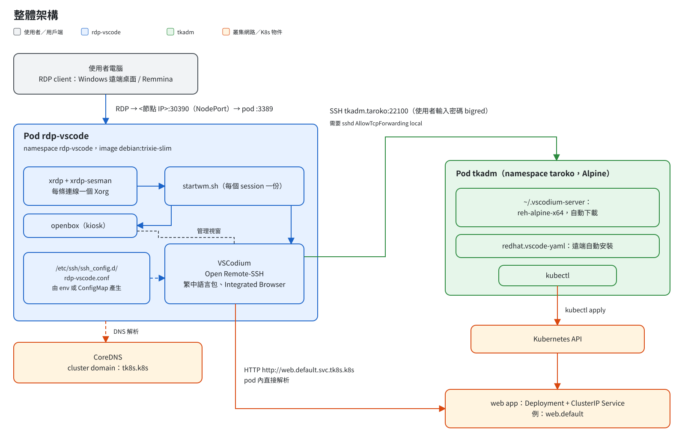
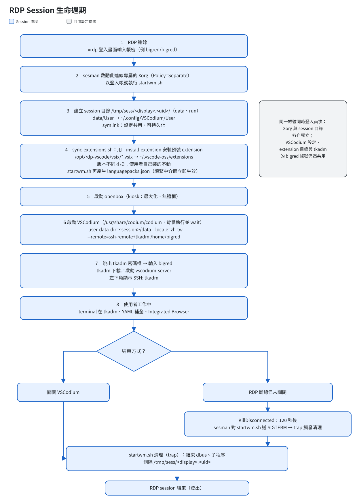

# 02 架構

## 整體架構



### 元件

| 元件 | 位置 | 角色 |
|---|---|---|
| RDP client | 使用者電腦 | Windows 遠端桌面、Remmina 等，連到 `<節點 IP>:30390` |
| xrdp + xrdp-sesman | rdp-vscode pod | 接受 RDP 連線，替每條連線各自啟動一個 Xorg |
| openbox | rdp-vscode pod | 視窗管理員，kiosk 模式：所有視窗最大化、無邊框 |
| VSCodium | rdp-vscode pod | 編輯器本體，內含 Open Remote-SSH、繁中語言包、Integrated Browser |
| `rdp-vscode.conf` | rdp-vscode pod 的 `/etc/ssh/ssh_config.d/` | 由 entrypoint 依照環境變數或 ConfigMap 產生的 SSH Host 設定 |
| tkadm | namespace `taroko` | 既有的管理 pod（Alpine），SSH port 22100，裡面有 `kubectl` |
| vscodium-server | tkadm 的 `~/.vscodium-server` | 第一次連線時，Open Remote-SSH 會自動下載的 `reh-alpine-x64` |
| CoreDNS | kube-system | 負責解析 Service 名稱；tk8s 的 cluster domain 是 `tk8s.k8s` |

### 連線流程

1. 使用者用 RDP 連到 NodePort `30390`，在 xrdp 登入畫面輸入帳密
2. 畫面出現全螢幕的 VSCodium，它自動對 `tkadm` 發起 SSH 連線（`tkadm.taroko:22100`）
3. 使用者在密碼框輸入 `bigred`。tkadm 上會下載並啟動 vscodium-server，再自動安裝 `redhat.vscode-yaml`
4. 使用者在 VSCodium 裡編輯的檔案、開啟的 terminal，都是在 **tkadm 上**
5. 在 tkadm 上用 `kubectl` 部署網站後，直接用 Integrated Browser 打開 `http://<svc>.<ns>.svc.tk8s.k8s`（或短名稱 `http://<svc>.<ns>`）。rdp-vscode pod 本身就在叢集裡，所以**不需要 port forwarding、NodePort 或 Ingress**

## Session 生命週期



重點說明：

- **每條連線都是獨立的**：sesman 用 `Policy=Separate`。就算同一個帳號同時登入兩次，也會各自有一個 Xorg、一個 session 目錄 `/tmp/sess/<display>.<uid>/`，以及一個 VSCodium
- **設定可以共用、也能保留**：每個 session 的 VSCodium 資料目錄是獨立的，但其中的 `User/` 是 symlink，指向 `~/.config/VSCodium/User`。所以設定是同一份，在 stateful 模式下也會跟著 home 保留下來
- **每次登入都會同步預裝 extension**：見 [01-decisions.md 的 B5](01-decisions.md#d18b5-extension)
- **有兩種結束方式**：
  - 關閉 VSCodium → startwm.sh 執行清理 → session 立刻結束
  - RDP 斷線但沒有關閉 VSCodium → 120 秒後（`KillDisconnected`），sesman 對 startwm.sh 送出 SIGTERM，觸發 trap 執行同樣的清理，不會留下 Electron 程序繼續佔記憶體。因此 VSCodium 必須在背景啟動再 `wait`：如果在前景執行，bash 會把 trap 延到 VSCodium 結束後才執行。而且要直接執行 `/usr/share/codium/codium`，因為 `/usr/bin/codium` 是啟動器，會立刻返回

## 多帳號模型

```
rdp-vscode pod
├── bigred (uid 1000)  ── session :10 ── VSCodium ──┐
├── alice  (uid 1001)  ── session :11 ── VSCodium ──┼── SSH ──> tkadm（全部以 bigred 登入）
└── bob    (uid 1002)  ── session :12 ── VSCodium ──┘
```

- **在 rdp-vscode pod 裡**：每個帳號有自己的 UID 和 `/home/<user>`（權限 `0700`），彼此看不到對方的檔案
- **在 tkadm 上**：所有人共用 bigred 帳號，包括 home、vscodium-server 和 kubeconfig（B1）
- **UID 怎麼分配**：依照 `users.txt` 的順序，從 1000 開始。順序調換時，entrypoint 會把已存在的 home 重新 chown 給新的 UID

## Repo 目錄結構

```
rdp-vscode/
├── LICENSE                         # Apache-2.0
├── README.md / README.en.md        # 繁中（預設）／英文
├── VERSION
├── install.sh                      # 快速開始的 curl | bash 安裝腳本
├── images/rdp-vscode/
│   ├── Dockerfile
│   ├── rootfs/                     # 會複製進 image
│   │   ├── opt/rdp-vscode/
│   │   │   ├── entrypoint.sh       # 帳號、home、TLS、SSH 設定，最後啟動 xrdp
│   │   │   ├── accounts.sh         # 解析 users 檔，建立或更新帳號
│   │   │   ├── ssh-config.sh       # 依環境變數或 ConfigMap 產生 ssh_config
│   │   │   ├── sync-extensions.sh  # 同步預裝 extension
│   │   │   ├── languagepacks.js    # 啟動前產生 languagepacks.json，讓 --locale 立即生效
│   │   │   └── vsix/               # 預裝 extension 的 .vsix（build 時下載）
│   │   ├── etc/xrdp/startwm.sh     # 每個 session 的啟動與清理
│   │   └── etc/skel/               # 新 home 的初始內容（openbox kiosk 設定、VSCodium 預設設定）
├── manifests/                      # kustomize（見 03-deployment.md）
├── test/                           # unit、image、deploy、e2e 測試
└── docs/                           # architecture.md、user-guide.md、build-image.md、design/、ops/
```
