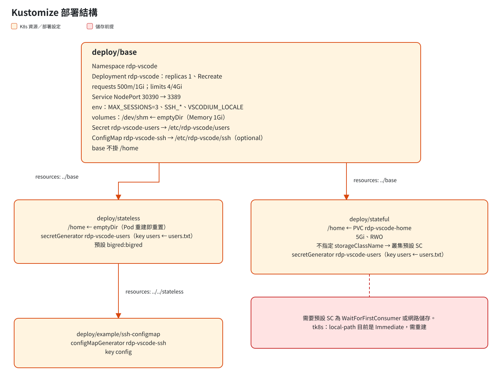

# 03 部署

## Kustomize 結構



| 目錄 | 用途 | `/home` |
|---|---|---|
| `manifests/base` | Namespace、Deployment、Service，以及共用的 volume 設定 | 不掛載 |
| `manifests/stateless` | 實驗或教學用，pod 重建後回到乾淨狀態 | emptyDir |
| `manifests/stateful` | 要保留 VSCodium 設定和使用者自己裝的 extension | PVC `rdp-vscode-home` |
| `manifests/example/ssh-configmap` | 範例：用 ConfigMap 自訂 ssh_config（以 stateless 為基礎） | emptyDir |

部署方式：

```bash
kubectl apply -k manifests/stateless   # 或 manifests/stateful
```

## Stateless 和 Stateful 的差異

| | Stateless | Stateful |
|---|---|---|
| pod 重建後 | 所有 home 都重置 | VSCodium 設定、使用者自己裝的 extension 都會保留 |
| 預裝的 extension | 每次登入時同步 | 每次登入時同步（升級 image 也會跟著更新） |
| 排程 | 任何節點 | 被 PVC 所在的節點綁住（local-path 的情況） |
| 前置需求 | 無 | 預設 StorageClass 要符合下面的條件 |

> 不管選哪一種，**真正的工作都是在 tkadm 上**。tkadm 的資料保留與否，是 tkadm 自己的設定決定的，不在本專案的範圍內。

## 儲存需求（Stateful）

- PVC：5Gi、RWO，**不指定 `storageClassName`**，使用叢集預設的 SC
- 預設 SC 必須是 `volumeBindingMode: WaitForFirstConsumer`（例如 local-path），或是網路儲存（NFS、Longhorn 等）
- 用 local-path 的限制：資料存在某一個節點上，那個節點掛掉時 pod 就起不來。正式環境建議改用網路儲存
- Deployment 要用 `replicas: 1`、`strategy: Recreate`，因為 RWO volume 不能讓兩個 pod 同時掛載

## 資源

| | 值 | 說明 |
|---|---|---|
| requests | `cpu: 500m`、`memory: 1Gi` | |
| limits | `cpu: 4`、`memory: 4Gi` | 以 3 人同時連線估算 |
| `/dev/shm` | emptyDir（Memory），1Gi | container 預設只有 64MB，Electron 不夠用容易 crash |
| `MAX_SESSIONS` | 3 | sesman 同時連線的上限 |

**每多一個同時連線的人，記憶體大約要加 1Gi。** 記憶體超過 limit 時，**整個 pod 會被 OOMKilled，所有人的 session 都會一起斷線**，所以 limit 寧可設寬一點。

## 環境變數

| 變數 | 預設值 | 用途 |
|---|---|---|
| `RDP_USER` / `RDP_PASSWORD` | `bigred` / — | 沒有掛 users 檔時使用的單一帳號 |
| `SSH_HOST_ALIAS` | `tkadm` | ssh_config 的 Host 名稱，也是自動連線的目標；設成空字串就不自動連線 |
| `SSH_HOST` | `tkadm.taroko` | HostName，用短名稱，靠 search domain 解析 |
| `SSH_PORT` | `22100` | Port |
| `SSH_USER` | `bigred` | User |
| `SSH_REMOTE_FOLDER` | `/home/$SSH_USER` | 自動連線後開啟的遠端資料夾 |
| `VSCODIUM_LOCALE` | `zh-tw` | 介面語言，可以設成 `en` |
| `VSCODIUM_FONT` | `cascadia-code` | 系統 `monospace` 字型（fontconfig），也就是編輯器和終端機的預設字型；可以設成 `jetbrains-mono` 或 `noto` |
| `MAX_SESSIONS` | `3` | 同時連線上限 |

## 掛載點

| 來源 | 掛載位置 | 說明 |
|---|---|---|
| Secret `rdp-vscode-users`（key `users`） | `/etc/rdp-vscode/users` | 一行一個 `帳號:密碼`，由 secretGenerator 從 `users.txt` 產生，預設是 `bigred:bigred` |
| ConfigMap `rdp-vscode-ssh`（key `config`） | `/etc/rdp-vscode/ssh/config` | optional；存在而且不是空的，就取代環境變數產生的 SSH 設定 |
| emptyDir 或 PVC | `/home` | 由 overlay 決定 |
| emptyDir（Memory，1Gi） | `/dev/shm` | Electron 用的共享記憶體；用預設的 64MB 時，載入中文字型會崩潰 |

## Image

| Tag | 內容 |
|---|---|
| `ghcr.io/braveantony/rdp-vscode:1.3` | 用內建的 Integrated Browser，約 1.3GB（`-firefox` 版已在 2026-10-29 移除） |

manifest 預設使用 `imagePullPolicy: IfNotPresent`。e2e 測試時，會用 kustomize 的 `images:` 換成本機 build 的 `localhost/rdp-vscode:dev`，再用 rdp-firefox 的方式載入 tk8s 的 worker 節點。

## tk8s 前置作業

> ⚠️ **這會修改叢集設定，執行前必須先經過同意。**

tk8s 目前的 `local-path` SC 是 `volumeBindingMode: Immediate`。這個 provisioner 在 pod 還沒排程時，不知道 volume 要建在哪個節點，所以會失敗：

```
failed to provision volume with StorageClass "local-path": configuration error, no node was specified
```

`vault` namespace 的 3 個 PVC 就是因為這個原因，已經 Pending 了 7 天。

處理步驟（Task 7 Step 0）：
1. 備份：`kubectl get sc local-path -o yaml > local-path-sc.bak.yaml`
2. 刪除並重建 SC，只把 `volumeBindingMode` 改成 `WaitForFirstConsumer`，其他欄位不變，也保留 default 的 annotation
3. 確認：`kubectl get sc local-path -o jsonpath='{.volumeBindingMode}'` 輸出 `WaitForFirstConsumer`

vault 那幾個已經 Pending 的 PVC 要不要處理，不在本專案的範圍內，只會回報狀態。
