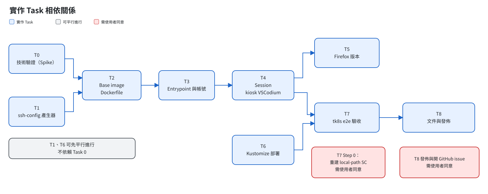

# 04 實作路線圖

執行方式：**Native**。在同一個 session 裡依序完成每個 task，最後再找一位 reviewer 檢查整體。每個 task 都走 TDD：先寫一個會失敗的測試，再實作，最後確認測試通過並 commit。

## 相依關係

- Task 1 和 Task 6 不依賴 Task 0，可以先平行進行
- 標示 ⚠️ 的步驟會影響外部環境，**執行前要先經過同意**

## 各 Task 說明

### Task 0：技術驗證（Spike）
**為什麼要先做：** 有 8 件事只能實際跑過才知道，後面的設計都依賴這些結果。

| # | 要驗證的問題 | 影響哪裡 |
|---|---|---|
| 1 | 非 root 執行 VSCodium 時，需不需要 `--no-sandbox`？ | Task 4 的啟動參數 |
| 2 | 用 `codium & wait $!` 啟動時，關閉視窗 wait 才返回嗎？斷線時 startwm.sh 會收到 SIGTERM 並清理嗎？ | 「關掉就登出」與斷線清理 |
| 3 | Open Remote-SSH 連到 Alpine 的 tkadm 時，能不能跳出密碼框、下載 server？ | **整個方案的前提** |
| 4 | 怎麼讓 `redhat.vscode-yaml` 自動安裝到遠端？ | Task 4 的設定 |
| 5 | 能不能讓叢集內的網址預設用 Simple Browser 開啟？ | Task 4 的設定 |
| 6 | 每個 session 用獨立的資料目錄、`User/` 用 symlink 共用，這樣可行嗎？ | 同帳號同時登入兩次 |
| 7 | ControlMaster 跟 Open Remote-SSH 相容嗎？ | B4 是保留還是拿掉 |
| 8 | 直接複製 extension 目錄時，VSCodium 會不會載入？ | B5 同步機制 |

**產出：** `docs/spike-notes.md`，以及固定的版本號（VSCodium、Open Remote-SSH、繁中語言包）。
**停損點：** 如果第 3 題的結論是做不到，就停下來重新討論，因為這會推翻選用 VSCodium 的決定。

### Task 1：Repo 初始化與 ssh-config 產生器
- 初始化 git repo，加入 Apache-2.0 授權和測試輔助函式
- `ssh-config.sh`：根據環境變數產生 SSH 設定；有 ConfigMap 時改用 ConfigMap 的內容
- **完成條件：** 5 個單元測試通過（預設值、環境變數覆寫、ConfigMap 優先、空的 ConfigMap 退回預設、錯誤的 port 會被拒絕）

### Task 2：Base image（Dockerfile）
- 以 Debian trixie 為基礎，裝 xrdp、openbox、中文字型，以及固定版本的 VSCodium 和預裝 extension
- build 時檢查 tkadm 要用的 `reh-alpine-x64` 存在
- **完成條件：** smoke 測試通過（版本正確、套件都在、xrdp 設定正確、image 裡不含金鑰）

### Task 3：Entrypoint 與帳號管理
- `accounts.sh`：從 `users.txt` 建立帳號，home 權限設 `0700`，UID 改變時重新 chown
- `entrypoint.sh`：建立帳號 → 產生 SSH 設定 → 產生 TLS 金鑰 → 啟動 xrdp
- **完成條件：** 帳號測試通過（密碼用雜湊比對驗證、帳號隔離、home 保留、模擬 pod 重啟時調換 UID）

### Task 4：Session（kiosk VSCodium）
- `startwm.sh`：建立 session 目錄 → 同步 extension → 啟動 openbox 和 VSCodium → 結束時清理
- openbox kiosk 設定、VSCodium 預設設定（YAML schema、關閉自動更新）
- **完成條件：** 用 FreeRDP client 實際登入，驗證 kiosk 畫面、語系切換、關閉後登出、同帳號登入兩次、斷線清理、設定共用、extension 同步

### Task 5：Firefox 版本
- `WITH_FIREFOX=1` 會多裝 Firefox ESR，並設為預設瀏覽器
- **完成條件：** 兩個 tag 都通過測試，而且只差最後一層 layer

### Task 6：Kustomize 部署
- base、stateless、stateful、ssh-configmap 範例
- **完成條件：** 每個 overlay 都能正確 render，並通過 `kubectl apply --dry-run=server`

### Task 7：tk8s e2e 驗收
- ⚠️ **Step 0：重建 tk8s 的 `local-path` SC**（見 [03-deployment.md](03-deployment.md#tk8s-前置作業)）
- `tests/e2e/run.sh [stateless|stateful|all]`：build image → 載入節點 → 部署 → RDP 登入 → 逐項驗證
- **完成條件：** 自動化的驗收項目全部通過，手動清單交給使用者確認（見 [05-acceptance.md](05-acceptance.md)）

### Task 8：文件與發佈
- 寫 `README.md`、`README.zh-TW.md`、`build-image.md`、`user-guide.md`
- ⚠️ **Step 6：建立 GitHub repo、推送 image 到 ghcr.io**
- ⚠️ **Step 7：開 GitHub issue，記錄 `-firefox` 版本還沒有 e2e 涵蓋的部分**
