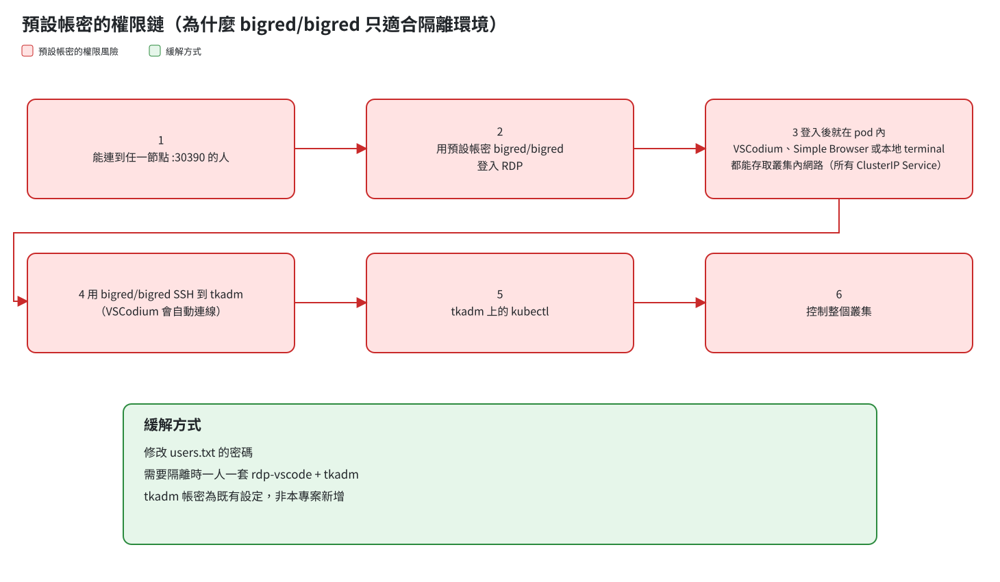

# 06 風險、限制與 Review 紀錄

## 安全風險

**預設帳密 bigred/bigred 只適合隔離的實驗環境。** 只要能連到任何一個節點的 port 30390，就能沿著這條路一路取得整個叢集的控制權：

1. 用預設帳密登入 RDP
2. 登入後就在 pod 內：透過 VSCodium、Integrated Browser 或本地 terminal，都能存取叢集內所有 ClusterIP Service（**不需要另外取得 shell**，所以關掉本地 terminal 並不會讓它變安全）
3. 用 bigred/bigred SSH 到 tkadm（VSCodium 會自動連線）
4. 用 tkadm 上的 kubectl 控制整個叢集

緩解方式：
- 修改 `users.txt` 裡的密碼
- 需要隔離時，一人部署一套 rdp-vscode 加 tkadm

> tkadm 的帳密是叢集**原本就有**的設定，不是本專案新增的風險。本專案的決定（B6）是維持預設值，並在 README 開頭和 `users.txt` 加上明顯的警告。

## 已知限制

| 限制 | 說明 |
|---|---|
| 共用 tkadm 帳號 | 所有 RDP 帳號都以 tkadm 的 bigred 登入，會互相改到檔案，也共用 kubeconfig 的權限（B1） |
| tkadm 重啟後要重新下載 server | `~/.vscodium-server` 沒有持久化，下次連線會重新下載約 60MB |
| Extension 生態系 | 只能用 Open VSX 的 extension，Pylance、C# Dev Kit、Copilot 等不能用 |
| Image 大小 | 約 1.3GB；`-firefox` 版本約 1.6GB |
| 記憶體 | 每多一個人約加 1Gi；超過 limit 時整個 pod 被 OOMKilled，所有人一起斷線 |
| local-path 綁定節點 | stateful 模式下，節點掛掉時 pod 就起不來 |
| 中文輸入 | 不支援在 pod 裡打中文，要在本機打好再用剪貼簿貼上 |
| 沒有 session 分享 | 第一版不做（D9） |
| 每次連線都要輸入 tkadm 密碼 | 包括 `Reload Window`；ControlMaster 對 Open Remote-SSH 沒有作用（B4 已拿掉） |
| xrdp 以 root 執行 | Debian trixie 的 xrdp 0.10.1 不支援降權，跟 rdp-firefox 不同 |
| 點連結不會用內建瀏覽器開 | 要自己開 Integrated Browser；只有 `-firefox` 版本點連結會開 Firefox |

## Task 0 驗證過的假設

| 假設 | 結果 |
|---|---|
| Open Remote-SSH 能在 Alpine 的 tkadm 上運作 | 可以，但 tkadm 的 sshd 必須改成 `AllowTcpForwarding local` |
| ControlMaster 跟 Open Remote-SSH 相容 | 沒有作用，已拿掉，每次連線都輸入密碼 |
| `codium & wait $!` 在視窗關閉時才返回，斷線時 trap 會執行清理 | `codium` 會立刻返回；改成直接執行 `/usr/share/codium/codium` 後，關閉和斷線清理都正常 |
| 直接複製 extension 目錄就能被載入 | 不行，改用 `--install-extension` |
| Electron 在容器裡的 sandbox 能正常運作 | 可以，不需要 `--no-sandbox` |

## 重要發現

| 發現 | 怎麼發現的 | 影響 |
|---|---|---|
| **tk8s 的 cluster domain 是 `tk8s.k8s`，不是 `cluster.local`** | review 第 8 項，實際用 DNS 查詢 | `SSH_HOST` 改用短名稱 `tkadm.taroko`；驗收用的網址改成 `.svc.tk8s.k8s` |
| tk8s 的 `local-path` SC 是 `Immediate`，PVC 會一直 Pending | brainstorming 盤點，查到 vault 的 PVC 已經 Pending 7 天 | stateful 模式需要先重建 SC |
| 從 host 連不到 NodePort，但連得到 ClusterIP | review 第 8 項 | 本機測試改用叢集 DNS 連 tkadm |
| Ubuntu 的 AppArmor 擋住了 Codex 內建的 bwrap | Codex 第一次 review 失敗 | 安裝系統的 `bubblewrap` 後解決 |

## Review 修正紀錄

計畫先經過 Codex（gpt-6-astra）review，再由 Fable 5.1 評估 Codex 的意見並補充，最後逐項跟使用者確認後修改。

| # | 來源 | 問題 | 修正 |
|---|---|---|---|
| 1 | Codex | `uid-reorder` 測試的斷言太弱，UID 沒變也會通過 | 改在新容器中掛同一個 `/home` 測試，並檢查兩個帳號的 UID 和檔案擁有者 |
| 2 | Codex | Task 3 檢查的 `rc.xml` 要到 Task 4 才建立 | Task 3 改檢查 `.bashrc` |
| 3 | Codex | kustomize 路徑會解析成 `deploy/deploy/stateless` | 改成 `../../stateless` |
| 4 | Codex | `YAML_EXT_VERSION` 沒有被任何步驟用到 | 不固定遠端 extension 的版本，D16 寫清楚固定的範圍 |
| 5 | Codex | e2e 的 firefox 模式沒有換成 firefox 版的 image | 拿掉 e2e 的 firefox 模式，改在發佈後開 GitHub issue 追蹤 |
| 6 | Codex | 以 root 執行 `su` 不會檢查密碼 | 改成比對密碼雜湊，並加上反向檢查 |
| 7 | Codex | AC3、AC8 可能在沒有真正驗證到的情況下通過 | AC3 用 marker 檔判斷；AC8 改成重新登入後再讀設定 |
| 8 | Fable | Task 4 的 SSH 目標把 port 寫在 `SSH_HOST` 裡 | 改用叢集 DNS 和短名稱，port 由 ssh config 提供 |
| 9 | Fable | smoke 容器跑完沒有清除 | 用固定名稱，測試結束時一律清除 |
| 10 | Fable | 決策編號 D11 重複 | Host key 改成 D11a |
